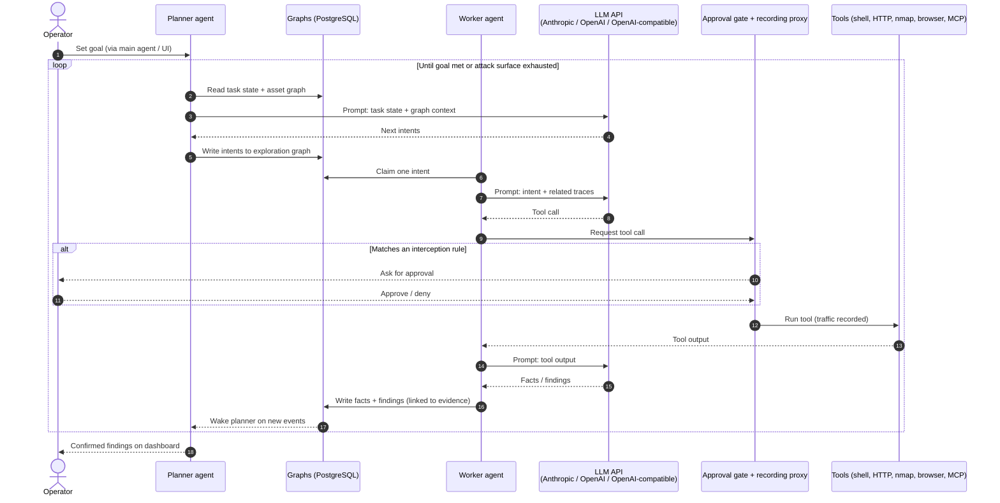

## 1. What ARTEX is

ARTEX is an open-source, multi-agent penetration-testing framework written in Go. An independent developer using the handle **Autumn-27** published it on GitHub in July 2026 as a legitimate red-team tool, meant to run inside an isolated lab.

The key point to understand: **ARTEX is not an AI model.** It is a *harness* — software wrapped around a large language model (LLM). The LLM supplies the reasoning ("what should I try next?"); ARTEX supplies memory, tools, coordination and logging so the model can actually carry out a multi-step test.

Within about three months it went from a GitHub research project to the engine behind some of the fastest-moving AI-assisted intrusions of 2026. On 8 October 2026 the developer stopped updates and took the project closed-source, citing misuse — but forks and backups remain public.

## 2. How ARTEX works

### 2.1 The agent team

ARTEX splits a test into roles played by cooperating LLM agents:

| Agent | Job |
| --- | --- |
| **Planner** | Event-driven. Reads the current task state, decides the next step and dispatches "intents" (small units of work). Keeps a to-do list across wake-ups so dependent steps in a long chain happen in order. |
| **Workers** (N of them) | Each claims one intent and runs real tools — shell, HTTP requests, nmap, a headless browser (Playwright). Results are written back. Workers can search each other's execution traces within the same task. |
| **Main agent** | Lets a human steer the operation through a chat window. |

Google Threat Intelligence Group and Mandiant observed work split across **six sub-agents** in one intrusion, and recorded a burst of 27 events in 23 seconds — a pace no human operator produces.

### 2.2 The feedback loop

1. An operator sets a goal (for example, "assess this web app").
2. The planner maps the target and issues intents.
3. Workers run tools and report facts and findings.
4. Results flow back to the planner, which revises the plan and launches the next wave.
5. The loop repeats until the goal is met or the planner decides the attack surface is exhausted.

### 2.3 Two linked graphs (ARTEX's "memory")

- **Asset graph** — shared across tasks. Holds root domains, subdomains, IPs, services, apps and endpoints. De-duplication and parent links are computed by code, not by the model, which keeps the inventory reliable.
- **Exploration graph** — one per task. Nodes are *goals, intents, facts, findings and hints*, joined by edges such as *spawns*, *derived-from*, *yields* and *proves*. Every finding traces back to the intent and evidence that produced it. Anchors connect exploration nodes to the assets they touched, which drives a coverage map.

In plain terms: **goals spawn intents → intents yield facts → facts prove findings.**

### 2.4 Human safety controls (in the legitimate design)

- **Interception rules** — regex/string rules that pause a tool call for human approval, or block it outright (e.g., require approval for destructive commands, deny data exfiltration).
- **Approval log** — records every approve/deny decision.
- **Recording MITM proxy** — captures every request and response the agents send, so the whole test is auditable.

These gates are exactly what attackers turn off or ignore — a reminder that safety features in open-source dual-use tools are only as strong as the person running them.

### 2.5 Extensions

- **MCP servers** (remote, over HTTP or SSE) to plug in extra tools.
- **Skills** folder, mounted from `./skills`, for reusable playbooks.
- Optional asset import from **ScopeSentry**.

## 3. How ARTEX links to an LLM

ARTEX is **model-agnostic**. It talks to models from Anthropic or OpenAI, or to *any* service that exposes an OpenAI-compatible API. That last part matters: it means an operator can point ARTEX at a cheap reseller, a self-hosted open-weight model, or whichever provider has the weakest guardrails.

Here is one loop of an ARTEX task as a sequence diagram — every reasoning step is an LLM call, every action goes through the approval gate:

Each agent turn sends the model the current task state, relevant graph context and the latest tool output; the model replies with the next intent or tool call. The key is set either as an environment variable (e.g. an Anthropic API key in `.env`) or in the web UI.

**Token cost is real.** In one Vapor Panda intrusion, the planning agents alone consumed about **1.4 billion input tokens**.

**Model choice by attackers:** observed backends include DeepSeek v4.1-flash, GLM-5.3 (Zhipu AI), Grok 4.6 and unidentified commercial models. Check Point found that, across exposed operator databases, Chinese models (especially the DeepSeek Flash family) dominated; guardrails were triggered only when Anthropic's Opus 5.5 was used, after which the actor switched to more permissive models.

## 4. GitHub repo example: ARTEX Global Edition

The clearest public example today is **[jiwoochris/artex-global](https://github.com/jiwoochris/artex-global)**, an English-first "Global Edition" of ARTEX. It is not a GitHub fork. It describes itself as a localised edition of the original [Autumn-27/ARTEX](https://github.com/Autumn-27/ARTEX), which, along with its agent SDK *norma*, could no longer be reached in October 2026. Changes on top of the original are tracked in a changelog.

| Item | Detail |
| --- | --- |
| Repo | [github.com/jiwoochris/artex-global](https://github.com/jiwoochris/artex-global) |
| Upstream | Autumn-27/ARTEX (closed-source since 8 Oct 2026) |
| Stack | Go backend + Next.js frontend, embedded into one binary via `go:embed`, on PostgreSQL |
| Licence | GNU AGPL-3.0, plus extra usage restrictions and a disclaimer |
| Popularity | ~2.4k stars, ~2.4k forks, ~790 commits (Nov 2026) |
| Languages | UI and output in English by default; Korean, Chinese, Spanish and Japanese selectable |
| Deploy | Docker Compose (`ghcr.io/jiwoochris/artex-global` image), install script, or single-binary build |
| Security defaults | Binds to `127.0.0.1`, one-time setup token, rate-limited setup, CORS allow-list |

**What's different from the original**

- The UI and generated reports default to English. Agent *reasoning* prompts stay in their original language so the benchmarked behaviour doesn't change; only user-facing output is switched (via a directive in `agent/prompt.go`).
- It adds a stricter first-run setup, a legal notice and, unusually, a full set of **defender material**.

**Repo layout, mapped to the architecture in section 2**

| Folder | What it does |
| --- | --- |
| `agent/` | Planner, worker and main-agent logic and prompts |
| `llmpool/`, `llmrec/` | LLM client pool and recording of LLM calls (token spend) |
| `guard/`, `intercept/` | Approval gate and interception rules |
| `traffic/` | Recording MITM proxy for every agent request |
| `evidence/`, `report/` | Evidence behind findings, and report generation |
| `enrich/` | Asynchronous enrichment of assets |
| `mcphttp/`, `skills/` | Remote MCP servers and skill playbooks |
| `db/`, `config/` | PostgreSQL storage and configuration |
| `server/`, `cmd/artex/`, `web/` | HTTP server, Go entry point, Next.js dashboard |
| `detections/`, `docs/` | Defender guide, detection rules and indicators |

The README's architecture notes match section 2: a **goals** agent breaks the target into scope, the **planner** is the only agent that creates intents, **workers** each run one intent in parallel (3 per task by default), and a **main agent** handles human chat. A per-task to-do list lets the planner work through multi-step chains one dependent step at a time, and graph changes wake the planner for the next round.

**How it links to the LLM (from the config)**

- Set `ANTHROPIC_API_KEY` or `OPENAI_API_KEY`, or enter a key in the UI's LLM settings.
- Optional: `ARTEX_LLM_PROVIDER`, `ARTEX_LLM_MODEL`, `ARTEX_LLM_BASE_URL`, `ARTEX_LLM_PROXY`.
- Point `ARTEX_LLM_BASE_URL` at **any OpenAI-compatible endpoint** — this one setting is why attackers could swap in cheap or permissive models.
- The README warns that OpenAI-family models cap output at 16,384 tokens (the default 32,768 causes errors), and that reasoning models can return empty answers if their token budget is too small.

**Defender material in the repo**

The `detections/` and `docs/` folders include a defender guide (English and Korean), **Sigma** and **Suricata** rules, a MITRE **ATT&CK Navigator** layer, indicators in CSV and MISP formats, and a read-only host triage script. If you run a SOC, these are worth importing even if you never run the tool.

**Other copies.** [trhhubsd/ARTEX](https://github.com/trhhubsd/ARTEX) (v0.3.15, Oct 2026) also continues the original AGPL code, packaged as the `tomicdd/artex` Docker image.

> ⚠️ The repo itself says: use it only against systems you own or have **explicit written authorisation** to test, ideally in an isolated lab with deliberately vulnerable targets. Unauthorised scanning or exploitation is illegal in most countries (the README cites Korea's Network Act and PIPA). Treat any copy as untrusted third-party code.

## 5. Real incidents: how hackers used ARTEX

### 5.1 South Korean banks (late Sep – early Oct 2026)

- **Who:** An unidentified, Chinese-speaking, financially motivated actor (CrowdStrike, moderate confidence). Recorded Future tracks a related cluster as **TAG-217**, which was testing infrastructure as early as August 2026.
- **What:** Stole customer data from auxiliary systems at Shinhan Bank, KB Kookmin Bank and Hana Bank (initial counts ~25,000, 119 and 89 customers).
- **AI stack:** ARTEX with DeepSeek v4.1-flash as the main LLM, plus GLM-5.3 and Grok 4.6 driving additional Claude Code sessions.
- **How it was found:** Open web directories exposed the attacker's ARTEX config files and coding-assistant session histories.
- **Zscaler's follow-up:** The same operator's prompt history (4 Aug – 4 Oct 2026) showed targeting far beyond Korea — about 20 countries across SMS, retail, dating, education and crypto services. The operator chained multiple AI tools: one model attacked, another was asked to review the first model's work when it claimed to have run out of attack surface. Prompts sought bulk personal records and payment secrets for resale.

### 5.2 Vapor Panda espionage campaign (from 17 Oct 2026)

- **Who:** A China-nexus espionage group CrowdStrike tracks as **VAPOR PANDA**.
- **Scale:** 200+ organisations in at least 14 countries in under two weeks — government ministries, telecoms, defence contractors, banks and research groups. Nine confirmed compromises, including a Middle East interior ministry and a Latin American foreign ministry.
- **Techniques the agents chained:** reconnaissance → vulnerability exploitation → web shells → credential theft → alternative paths when blocked. Examples: an unsigned SAML assertion chained with XXE at a US pharma firm; LAPS and delegation abuse in Active Directory; and at a Greek government entity, unrotated **2022 mail-server keys** used to forge an admin token and read mailboxes.
- **Follow-on malware:** The BLOODALCHEMY backdoor (active since 2023) against government targets in Latin America and the Middle East.

### 5.3 Storm-0940 and ConnectWise Cloud Backup (Oct 2026)

- **Who:** A China-state-aligned group active since 2021, using ARTEX since at least September 2026.
- **How:** Abused stolen ConnectWise Cloud Backup (formerly SkyKick) app identities that already had consented Microsoft 365 permissions — no user sign-in needed.
- **Scale:** Sign-in attempts across 2,250+ Microsoft 365 tenants, failures peaking at 2,900 per minute; in some cases privileged cloud access in under three hours. ConnectWise disabled seven identities on 17 Oct. From 22 Oct the actor sprayed Okta, Entra and Cognito accounts at one-second intervals.

### 5.4 Seoul extortion ring (disclosed 26 Oct 2026)

- A seven-person criminal crew led by a 32-year-old former penetration tester.
- Targeted 90+ Korean organisations (academies, universities, hospitals, companies, golf courses); about 60 breached and roughly **8.2 million records** stolen.
- Extortion demands of about 360 million won (~US$270,000) across 38 incidents.

### 5.5 Taiwan: the 91APP e-commerce breach (Oct 2026)

**Victim.** 91APP is a Taiwanese e-commerce technology provider (founded 2013, listed 2021). Its Commerce Cloud product runs the online stores, apps, membership and order systems for hundreds of retail and food brands — so one breach hit many brands' customers at once.

**What happened.**

- On **3 Oct 2026, around 11:00**, an order database inside Commerce Cloud was accessed by an AI-driven automated penetration tool. The intrusion was fully cut off on **14 Oct at 23:00**.
- 91APP's 18-day investigation report (22 Oct) said investigators found **traces of ARTEX** in its systems, and noted the same class of tool had hit Korean banks, about 20 Japanese firms and 100+ US company websites in Sept–Oct.

**How the attackers got in (the attack chain).**

1. **Entry:** an internal productivity tool, **Appsmith**, running an un-updated component, was exposed and exploited to reach the internal network.
2. **Foothold:** investigators (CyCraft) traced an unauthorised process run on an internal **CI host** on 3 Oct.
3. **Secrets:** the attacker pulled **database keys stored in the company's GitLab**.
4. **Data access:** those keys opened a short-term order database holding up to 18 months of transactions.

None of these steps is novel. ARTEX's contribution was finding and chaining them quickly and automatically.

**Impact.**

- Because 91APP couldn't pinpoint exactly which orders were taken, it assumed the worst case: all online orders from **4 Apr 2025 to 14 Oct 2026** — **1,329 brands** and **4,798,255 consumers**.
- Exposed fields: name, phone number, delivery address, email and order history. No credit-card data; Marketing Cloud, 91APP Payments and iCHEF were not affected.
- Affected brands included Cosmed, hoi!, 2nd STREET Taiwan and many food and retail labels.
- **Fraud wave:** from 12 Oct, shoppers received scam emails quoting their *real* order details, claiming a "duplicate order" or "subscription" problem, and steering them to fake LINE accounts or ATM transfers.
- 91APP's share price fell to a record low (NT$45.6 on 3 Nov).

**Timeline.** 4 Oct first customer report → 8 Oct emergency team formed → 9 Oct CyCraft engaged → 14 Oct breach confirmed and blocked → 16 Oct public disclosure → 19 Oct Ministry of Digital Affairs on-site inspection → 22 Oct 18-day report names ARTEX → 29 Oct 25-day report gives full scope.

**Response.** 91APP removed the Appsmith tool, rotated every internal token and database credential, rebuilt GitLab permissions, separated test and production environments, and restricted host-to-database network paths. Chairman Ho Ying-chi apologised and admitted the company should have warned brand customers as soon as the emergency team formed on 8 Oct. 91APP promised full compensation for proven fraud losses, with claims open until 1 Feb 2027.

**Why it matters.** 91APP itself said the novelty of the tool doesn't change its responsibility — its patching and protection simply didn't keep pace with the attack speed. Taiwan's National Institute of Cyber Security head noted ARTEX can split an attack into small instructions to slip past AI guardrails, and in simulations moved more than 10× faster than humans. On 11 Nov the Ministry of Digital Affairs said nearly half of recent attacks on 10+ Taiwanese businesses and platforms involved AI, some of them ARTEX, with some traffic appearing to come from Hong Kong.

**Lesson for defenders:** patch internal tools too, never keep production secrets in source repos, and segment CI/CD from production data.

### 5.6 Other cases

- **Japan:** GMO Cybersecurity by Ierae linked ARTEX infrastructure to attacks on ~20 Japanese companies (disclosed 19 Oct).
- **WorkOS:** Detected unauthorised access to an internal sales/marketing app on 30 Oct; the CEO named ARTEX when disclosing on 2 Nov. Production services were not affected.
- **DIVD:** Reported an autonomous ARTEX attack on its own network that went from initial access to root in **12 minutes**, chaining a Zammad zero-day with a local privilege-escalation zero-day — over 450,000 requests and 2,500 scripts, "super loud and messy".
- **Cybercrime at scale (Check Point, 5 Nov):** 2,557 systems had hosted ARTEX panels (1,608 live). Goals included crypto theft, stealing code-signing certificates and gaming accounts, and DDoS against gambling sites. Operators mostly set a goal and checked back later — attacks ran largely on autopilot.

### 5.7 Timeline

| Date (2026) | Event |
| --- | --- |
| July | ARTEX published open-source on GitHub |
| Aug | TAG-217 begins preparing infrastructure |
| 3 Oct | 91APP (Taiwan) order database breached |
| 7–10 Oct | Korean bank attacks reported |
| 8 Oct | Developer goes closed-source |
| 15 Oct | Free detection rules published (Theori) |
| 17 Oct | Vapor Panda campaign starts; ConnectWise disables app identities |
| 19 Oct | Japanese victims disclosed |
| 22 Oct | 91APP report finds ARTEX traces |
| 26 Oct | Seoul police reveal extortion ring |
| 29 Oct | CrowdStrike Vapor Panda report |
| 29 Oct | 91APP confirms ~4.8M consumers, 1,329 brands affected |
| 2 Nov | WorkOS breach disclosed |
| 5 Nov | Check Point cybercrime analysis |
| 11 Nov | Taiwan MODA: ~half of recent attacks on Taiwan firms AI-linked, some ARTEX |

## 6. What this means — and how to defend

ARTEX didn't invent new hacking techniques. Its danger is **speed and scale**: familiar playbooks (SQL injection, password spraying, stale keys, over-privileged apps) executed at machine pace, by operators with little skill. There is no single patch for ARTEX; defence is good hygiene, done consistently.

**Detect the machine tempo**

- Sign-in failures spaced exactly one second apart, in 20–60-minute waves.
- Dozens of cloud enumeration events within seconds.
- Service principals suddenly gaining credentials, new IPs or privileged roles.
- Known artefacts: `C:\ProgramData\artx5v\`, command lines containing "artx"/"artex", cloud roles prefixed `artx`, files named `artex-probe-*`, repeated callbacks to webhook.site. Validate IOCs first — infrastructure rotates, and a tool name alone doesn't identify the actor.
- Theori has released free Sigma, Suricata, YARA and ModSecurity rules.

**Harden**

- Phishing-resistant MFA, smart lockout, block legacy auth.
- Inventory and prune third-party multi-tenant apps in Entra ID; least privilege; alert on new app credentials.
- Rotate long-lived mail signing keys, SAML certificates and API secrets; reject unsigned SAML.
- Enforce IMDSv2 on AWS; disable XML external entities.
- Patch CISA KEV flaws and internet-facing RCE/SQLi first; take admin interfaces off the internet.
- Restrict LAPS read access; monitor `msDS-AllowedToActOnBehalfOfOtherIdentity`.
- Export logs before deleting compromised apps or credentials.

As Censys researcher Silas Cutler put it, the fundamentals still hold: enforce MFA, watch your attack surface, practise credential hygiene.

## Sources

- [jiwoochris/artex-global — ARTEX Global Edition (GitHub)](https://github.com/jiwoochris/artex-global)
- [AI/TLDR — ARTEX tool overview](https://ai-tldr.dev/tools/artex/)
- [SOCRadar — ARTEX AI Pentest Tool: What Security Teams Need to Know](https://socradar.io/blog/artex-ai-pentest-tool-what-security-teams-need-to-know/)
- [BleepingComputer — ARTEX AI, Claude agents used in attacks on South Korean banks](https://www.bleepingcomputer.com/news/security/hacker-used-artex-ai-and-claude-agents-to-target-south-korean-banks/)
- [BleepingComputer — Chinese hackers use ARTEX AI against 200 orgs](https://bleepingcomputer.com/news/security/chinese-hackers-use-artex-ai-in-automated-attacks-against-200-orgs)
- [Zscaler ThreatLabz — Inside a global AI-assisted hacking campaign](https://zscaler.com/blogs/security-research/inside-global-ai-assisted-hacking-campaign)
- [Let's Data Science — Check Point details autonomous ARTEX attacks](https://letsdatascience.com/news/check-point-details-autonomous-artex-attacks-by-cybercrimina-9d8b6097)
- [Let's Data Science — ARTEX spreads to another China-linked group](https://letsdatascience.com/news/artex-ai-hacking-framework-spreads-to-another-china-linked-g-80a54aec)
- [Dark Reading — Artex: The AI pen-test tool hackers turned into a weapon](https://darkreading.com/cyberattacks-data-breaches/artex-ai-pen-test-tool-hackers-weapon)
- [SiliconReport — CrowdStrike: Vapor Panda targeted 200+ orgs](https://www.siliconreport.com/crowdstrike-says-vapor-panda-targeted-over-200-organizations-with-ai)
- [iThome — 91APP 18-day investigation report: ARTEX traces, Appsmith flaw](https://www.ithome.com.tw/news/179923)
- [Want Rich / China Times — 91APP report: Appsmith entry, GitLab keys, remediation](https://wantrich.chinatimes.com/news/20261029900479-420101)
- [Uanalyze / Anue — 91APP: up to 4.8M consumers affected](https://uanalyze.com.tw/articles/4816157965)
- [Global Views — What is the ARTEX attack on 91APP?](https://www.gvm.com.tw/article/134004)
- [Business Next — 91APP database attack and scam emails](https://www.bnext.com.tw/article/92706/91app-database-attack-scam-emails)
- [Focus Taiwan — Nearly half of recent cyberattacks on Taiwan firms AI-linked](https://focustaiwan.tw/sci-tech/202611110020)
